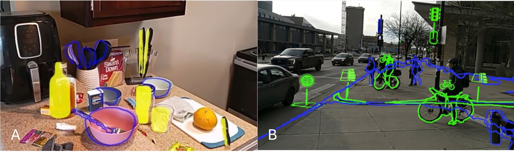

<p align="center">

  <h1 align="center">What to Distinguish and How? Opportunities and Challenges of Augmenting Multiple, Cluttered Objects in Complex Scenes for People with Low Vision</h1>
  <p align="center">
    Yuheng Wu<sup>1</sup>,
    Ruijia Chen<sup>1</sup>,
    Jaewook Lee<sup>2</sup>,
    Jia Li<sup>3</sup>,
    Kexin Zhang<sup>1</sup>,
    Meng Fong Lio<sup>1</sup>,
    Weibing Wang<sup>1</sup>, <br>
    Sanbrita Mondal<sup>1</sup>,
    Jon E. Froehlich<sup>2</sup>,
    Yapeng Tian<sup>3</sup>,
    Yuhang Zhao<sup>1</sup>
    <br><br>
    <sup>1</sup>University of Wisconsin-Madison,
    <sup>2</sup>University of Washington,
    <sup>3</sup>University of Texas at Dallas
    <br>
  </p>
  <h2 align="center">ASSETS 2026</h2>
  <h3 align="center"><a href="https://doi.org/10.1145/3797867.3828974">Paper</a> | <a href="./unity">Unity Frontend</a> | <a href="./python">Python Backend</a> | <a href="https://github.com/MadisonAbilityLab/SceneGlance/releases/tag/v1.0">Fine-Tuned Model Weights</a> | <a href="#citation">Citation</a></h3>
  <div align="center"></div>
<br>

</p>

<p align="center">
  
</p>

<br>

**SceneGlance** is a wearable augmented reality (AR) system that helps people with low vision perceive complex, cluttered scenes such as a busy kitchen or a crowded street. Instead of enhancing the entire scene equally, which can add visual clutter and distraction, SceneGlance detects the objects that are important to perceive for people with low vision and augments them directly in 3D space. Its core idea is **AR distinction**: instead of augmenting every important object with the same augmentation, SceneGlance visually distinguishes them by their importance so the most critical ones stand out while reducing overall visual load. It offers three base augmentations (Static Outline, Solid Overlay, and Icon Labels) and three distinction methods (By Form, By Color, and By Additional Visual Information) that users can customize and combine to fit their preferences and visual needs. It runs on Microsoft HoloLens 2 as frontend and a fine-tuned RTMDet segmentation backend that locates objects with the headset's depth mesh and renders the augmentations.

*The Paper link (DOI [10.1145/3797867.3828974](https://doi.org/10.1145/3797867.3828974)) will resolve once the ASSETS 2026 proceedings are published.*

## Citation

> ⚠️ **Placeholder.** The official ASSETS 2026 citation (proceedings title, pages, DOI) will be
> added once the paper is published. Do not use the BibTeX below for formal citation yet.

If you use SceneGlance in your research, please cite our work:

```bibtex
@inproceedings{wu2026distinguish,
  title={What to Distinguish and How? Opportunities and Challenges of Augmenting Multiple, Cluttered Objects in Complex Scenes for People with Low Vision},
  author={Wu, Yuheng and Chen, Ruijia and Lee, Jaewook and Li, Jia and Zhang, Kexin and Lio, Meng Fong and Wang, Weibing and Mondal, Sanbrita and Froehlich, Jon E. and Tian, Yapeng and Zhao, Yuhang},
  booktitle={Proceedings of the ACM SIGACCESS Conference on Computers and Accessibility (ASSETS '26)},
  year={2026}
}
```

## Acknowledgements

We thank the University of Wisconsin-Madison Ability Lab, the University of Washington, and the University of Texas at Dallas. Special thanks to the accessibility community for their invaluable feedback and testing.

Codebase refactored for release with help from Claude.ai.

For questions and support, please open a GitHub Issue or contact Yuheng Wu ([iamwyh.com](https://iamwyh.com)) at the MadAbility Lab at UW-Madison.

## License

This project is licensed under the Creative Commons Attribution 4.0 International License (CC-BY-4.0). See the [LICENSE](LICENSE) file for details.

You are free to share and adapt this work for any purpose as long as you provide appropriate attribution to the original authors.
